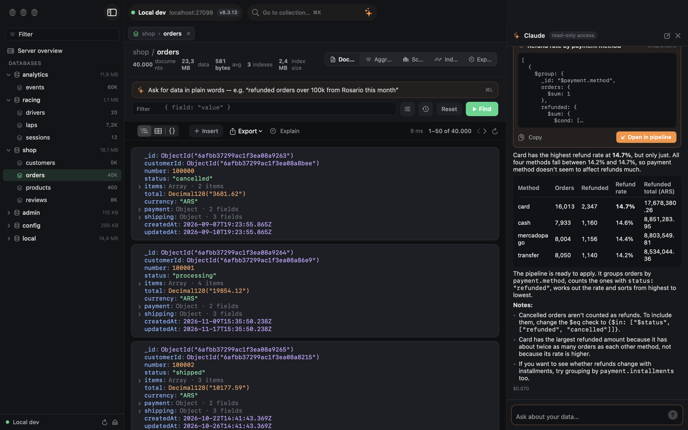
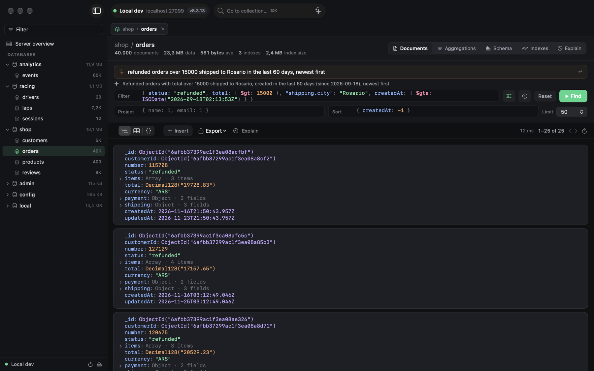
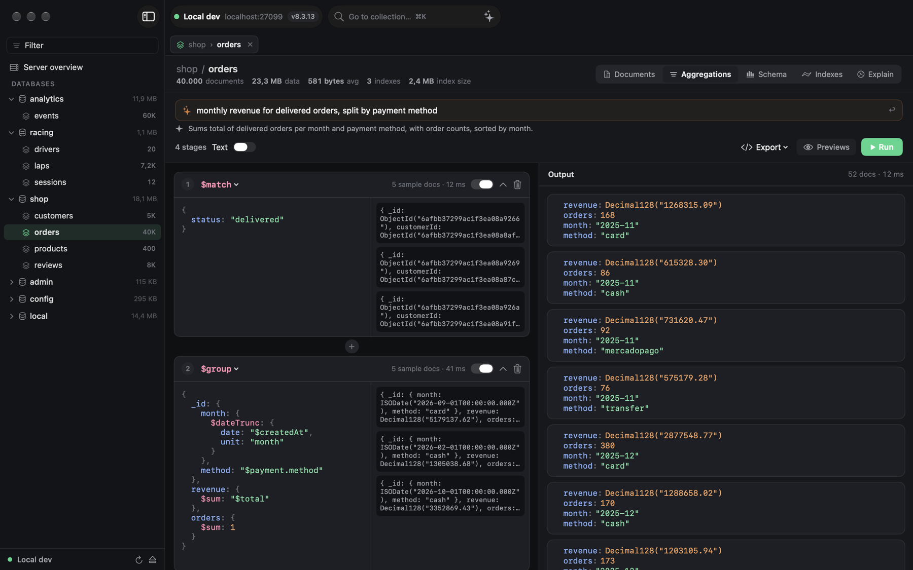
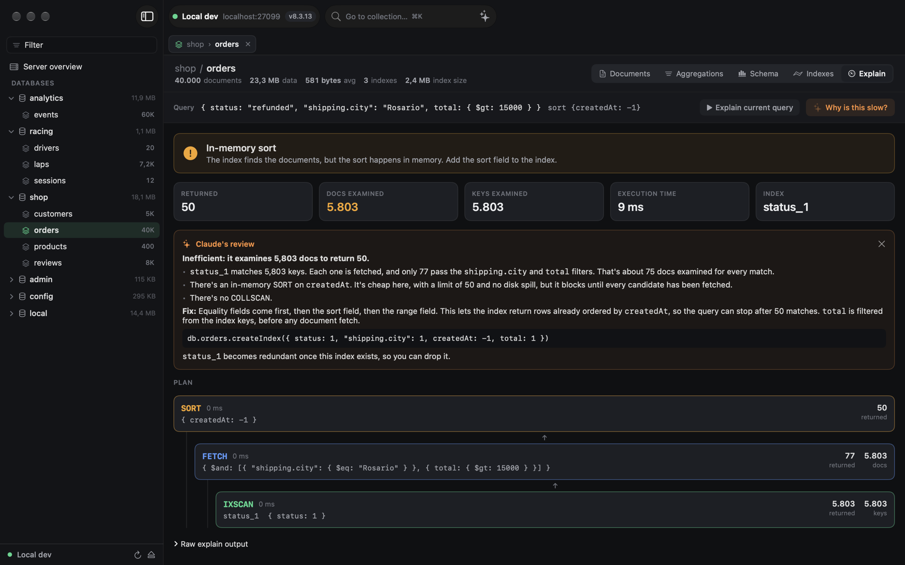
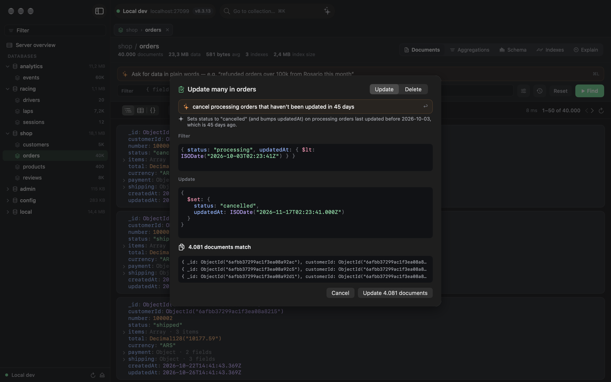
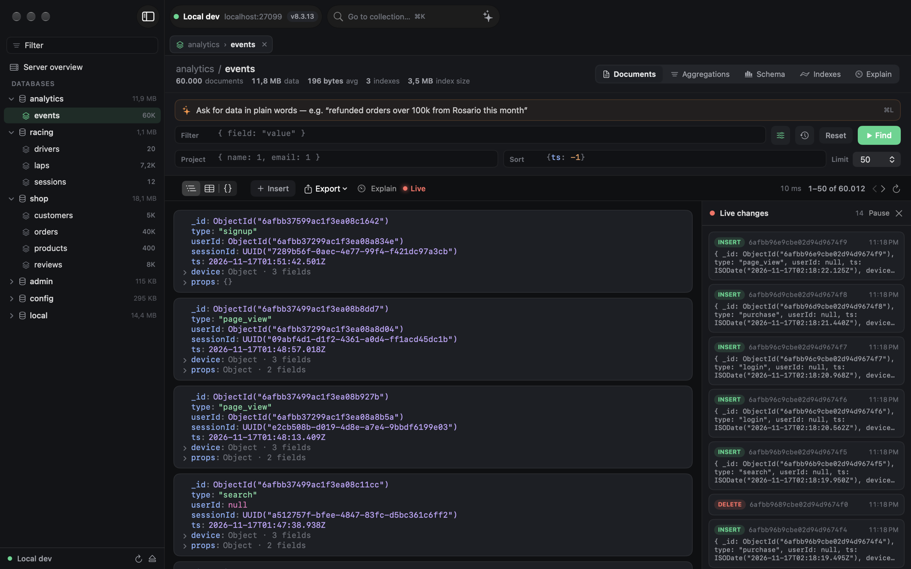
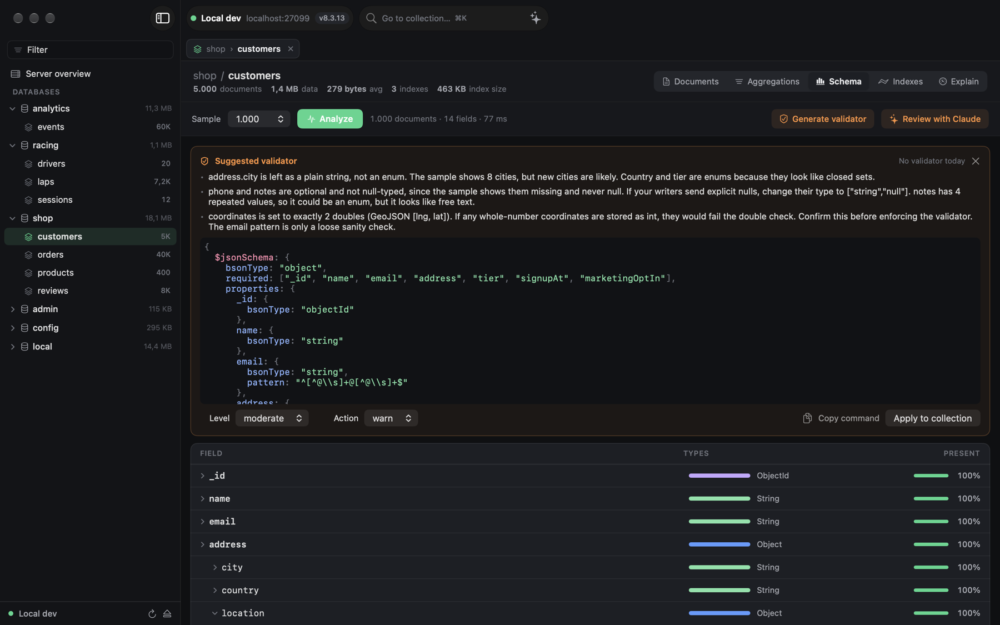
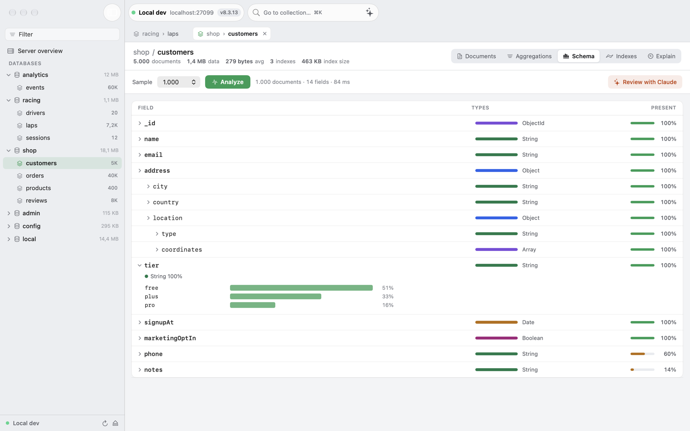

<p align="center"></p>

<h1 align="center">Canopy</h1>

<p align="center"><b>A fast, native home for your MongoDB data.</b><br>
A macOS MongoDB client built with SwiftUI and AppKit, with Claude built in.</p>

---

## Highlights

**Ask in plain words.** Type "refunded orders over 15k shipped to Rosario in the last 60 days, newest first" and Claude writes the filter and sort against your real schema (it samples the collection first), then runs it. The query bar stays editable, so you can see and tweak exactly what it wrote.

<p align="center"></p>

**A copilot that looks before it answers.** `⌘J` opens Claude with read-only tools for the connected deployment: list collections, sample schemas, run finds and aggregations, read indexes, explain plans. Every tool call is shown in the transcript. When it finds a useful query it hands you a card with an **Apply** button that loads it into the query bar or pipeline builder.

**Pipelines without the pain.** Describe an aggregation and Claude builds the stages. Every stage shows a live preview of its output, stages can be toggled and reordered, and the whole pipeline exports as mongosh, Node.js, Python or Extended JSON.

<p align="center"></p>

**Explain plans you can read.** A verdict up top (collection scan, unselective index, in-memory sort or efficient), the numbers that matter, and the plan as a tree. "Why is this slow?" asks Claude for the fix, with the exact index to create following the ESR rule.

<p align="center"></p>

**Everything else you reach for.**
- **Documents** as a list (expandable tree), a native table, or raw JSON. Edit inline, clone, delete, insert. Right-click any value to filter by it.
- **Query bar** that understands what people type: mongosh syntax, Extended JSON, unquoted keys, `ObjectId()`, `ISODate()`, `/regex/i`, comments, trailing commas. Errors point to the line and column.
- **Bulk update and delete** with a live match count and sample before anything runs. Describe the change ("cancel processing orders not updated in 45 days") and Claude writes the filter and `$set`.
- **Schema** analysis from a sample: every field path, its types, presence, top values, histograms for numbers and dates, a map for GeoJSON points, mixed-type warnings. Click a value to filter by it. "Review with Claude" flags data-quality issues, and "Generate validator" writes a `$jsonSchema` you can apply with `collMod` (warn or error, moderate or strict).
- **Import** by dropping a JSON array, NDJSON or CSV file onto a collection (dotted CSV headers become nested fields).
- **Keyboard first:** `⌘K` palette, `⌘L` ask, `⌘↩` run, `⌘E` explain, `⌘1`–`⌘5` switch views, `↑`/`↓` through documents, `↩` to edit, `⌘C` to copy.
- **Indexes** with sizes and real usage counts (`$indexStats`), create and drop, and index suggestions from the queries you actually ran.
- **Live** mode tails the collection's change stream: inserts, updates (with changed fields) and deletes as they happen.
- **Server overview** with live operations per second, connections, memory, database sizes and running operations (with Kill).
- **Command palette** (`⌘K`) to jump to any collection or action, tabs, query history with favorites, CSV/JSON export.
- **Connections** with passwords in the Keychain, color tags, and a **read-only** switch that blocks writes, drops and `$out` from the app.
- **Production connections** are marked in red everywhere (toolbar badge, a red edge on the workspace) and ask for **Touch ID or your Mac password** before deletes, drops, bulk updates, imports, index and validator changes, `$out`/`$merge` pipelines and killing operations.
- **Switch connections** from the toolbar (click the connection name), `⌃⌘1`–`⌃⌘9`, or `⌘K`.

<p align="center"></p>
<p align="center"></p>
<p align="center"></p>
<p align="center"></p>

## How Claude is wired in

Canopy runs Claude through your existing [Claude Code](https://claude.com/code) install (`claude -p`), so there's no API key to paste: it uses your login. One-shot features (query bar, pipelines, bulk updates, schema and explain reviews, index suggestions) use structured output. The copilot streams a full agent turn and reaches the database through a tiny MCP server that Canopy runs on `127.0.0.1` with a random token in the path.

That MCP server is read-only by construction (`aggregate` rejects `$out`/`$merge`, and the server itself rejects them inside `$facet`, `$lookup` and `$unionWith`): it exposes `find`, `aggregate` (with `$out` and `$merge` rejected), `count`, `collection_schema`, `list_*` and `explain`, plus `propose_query`, which only shows a card in the UI (proposals can't contain write stages either, and applying one never runs a write). Results are capped in size. Claude never gets write tools; writes always go through a confirmation in the app.

Models are configurable in Settings (Opus for the copilot, Sonnet for quick actions by default).

## Build

Needs macOS 15+, Xcode 16+ and [XcodeGen](https://github.com/yonaskolb/XcodeGen).

```sh
xcodegen generate
xcodebuild -project Canopy.xcodeproj -scheme Canopy -configuration Debug -derivedDataPath build/dd build
open build/dd/Build/Products/Debug/Canopy.app
```

Tests: `xcodebuild -project Canopy.xcodeproj -scheme Canopy -derivedDataPath build/dd test` (parser, Extended JSON, Decimal128, BSON bridging, type preservation on edit, schema, CSV import, connection strings, MCP request parsing).

### Releases and updates

Canopy updates itself with [Sparkle](https://sparkle-project.org). `scripts/release.sh` builds a signed Release, makes `build/release/Canopy-<version>.dmg`, signs it with the Sparkle EdDSA key from your keychain (account `canopy`) and writes `build/release/appcast.xml`. `scripts/release.sh --publish notes.md` also creates the GitHub release; the app reads the appcast from the latest release (`SUFeedURL` in `Resources/Info.plist`). Bump `CURRENT_PROJECT_VERSION` in `project.yml` for every release.

### Demo data and recordings

```sh
docker run -d --name canopy-mongo -p 27099:27017 mongo:8 --replSet rs0
mongosh "mongodb://localhost:27099/?directConnection=true" --eval 'rs.initiate({_id:"rs0",members:[{_id:0,host:"localhost:27017"}]})'
mongosh "mongodb://localhost:27099/?directConnection=true" scripts/seed.js   # shop, racing, analytics
scripts/demo.sh   # isolated instance, scripted tour, writes build/demo/canopy-demo.mp4 and .gif
```

`scripts/run-dev.sh` starts an isolated debug build (`CANOPY_HOME=build/home`) with an automation port; `scripts/ctl` drives it (`connect`, `open db coll mode`, `filter`, `ask`, `copilot`, `snapshot path.png`, `record start|stop`, …). Snapshots and recordings are rendered in-process, so they need no screen-recording permission.

## Layout

```
Canopy/
  App/        entry point, menus and shortcuts, automation hook
  Mongo/      BSON value model, mongosh/EJSON parser and printer, MongoService (raw commands), schema analysis
  Model/      connections + Keychain, session tree, per-tab view models, history
  AI/         Claude Code runner, MCP tool server, copilot, one-shot AI actions
  UI/         SwiftUI views (documents, table, aggregations, schema, indexes, explain, server, copilot, palette)
```

Built on [MongoKitten](https://github.com/orlandos-nl/MongoKitten) for the wire protocol, auth, TLS and topology; everything else is Canopy's own.
